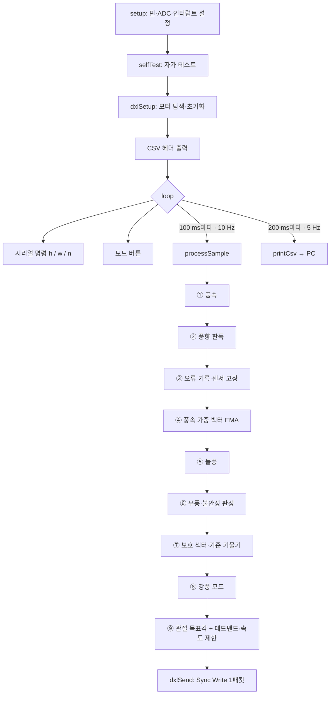

# 풍향·풍속 전처리 및 리브 제어 알고리즘 보고서

> 대상 코드: [`wind_preprocess/wind_preprocess.ino`](../wind_preprocess/wind_preprocess.ino) (ESP32 펌웨어), [`wind_logger.py`](../wind_logger.py) (PC 수집·분석)

---

## 목차

1. [한 줄 요약](#1-한-줄-요약)
2. [하드웨어 구성](#2-하드웨어-구성)
3. [각도 규약](#3-각도-규약)
4. [전체 흐름](#4-전체-흐름)
5. [단계별 상세 설명](#5-단계별-상세-설명)
6. [다이나믹셀 제어](#6-다이나믹셀-제어)
7. [출력과 PC 쪽 도구](#7-출력과-pc-쪽-도구)
8. [한계점 분석](#8-한계점-분석)
9. [실험 후 정해야 할 값](#9-실험-후-정해야-할-값)
10. [사용법](#10-사용법)

---

## 1. 한 줄 요약

```
센서 원시값  →  정제된 바람 특징값(WindFeatures)  →  리브 8관절 목표각(RibTargets)  →  다이나믹셀 8개
```

몸에 단 풍속계·풍향계로 바람을 10 Hz로 측정합니다. 측정값은 **풍속을 가중한 벡터 평균**으로 정제하고, 바람이 불어오는 쪽 리브를 내려 비를 막도록 4개 리브의 8개 관절 각도를 계산해 모터에 보냅니다. 바람이 너무 세면 리브를 접는 **강풍 안전 모드**로 들어갑니다.

---

## 2. 하드웨어 구성

| 구분 | 내용 |
|---|---|
| MCU | ESP32-DevKitC (Arduino IDE, arduino-esp32 core 3.x) |
| 센서 | SparkFun Weather Meter (SEN-15901) 풍속계 + 풍향계 |
| 모터 | 다이나믹셀 8개 (XL330 또는 XL430, **미확정**). ESP32에 직접 연결 |
| 라이브러리 | Dynamixel2Arduino |

### 핀 배치

| 핀 | 용도 |
|---|---|
| GPIO27 | 풍속계 리드 스위치 (GND와 연결, 내부 풀업, 하강 에지 인터럽트) |
| GPIO34 | 풍향계 전압 분배 출력 (ADC1, 10 kΩ 풀업) |
| GPIO0 | 캐노피 모드 버튼 (DevKitC BOOT 버튼) |
| GPIO17 / 16 | Serial2 TX / RX → 반이중 버퍼 → 모터 DATA |
| GPIO4 | 반이중 방향 제어 (HIGH = 송신) |

> 모터 전원(XL330 5 V / XL430 11.1 V)은 ESP32와 따로 공급하고, **GND는 반드시 공통으로 묶습니다.**

### 리브 구성 (등에 메는 하우징)

| 리브 | 이름 | 덮는 방향 | 관절 |
|---|---|---|---|
| r1 | Top_L | 315° (앞왼쪽 위) | J1, J2 |
| r2 | Top_R | 45° (앞오른쪽 위) | J1, J2 |
| r3 | Side_L | 270° (왼쪽) | J1, J2 |
| r4 | Side_R | 90° (오른쪽) | J1, J2 |

- **J1**(리브 뿌리): 리브 전체를 올리거나(+) 내립니다(−)
- **J2**(리브 중간): 끝을 펴거나(+) 아래로 굽힙니다(−)
- 0° = 기준 자세(리브 펼침)
- 리브 방향 각도는 설계 이미지를 보고 잡은 **추정값**입니다.

---

## 3. 각도 규약

파일 전체에서 같은 규약을 씁니다.

- **풍향 = 바람이 불어오는(FROM) 방향**
- 사용자 정면 0°, 위에서 내려다볼 때 **시계방향으로 증가**

```
              0° (정면에서 불어옴)
                    ↑
  270° (왼쪽) ←   사용자   → 90° (오른쪽)
                    ↓
              180° (등 뒤)
```

- 벡터 성분: `u = v·sinθ` (+ 이면 오른쪽에서 오는 성분), `w = v·cosθ` (+ 이면 정면에서 오는 성분)
- 우산은 **바람이 불어오는 쪽으로 기울입니다.** → `tilt_dir_deg = 평활된 풍향`
- 센서가 몸에 붙어 있어서 측정값은 **겉보기 바람**(실제 바람 + 걸으면서 생기는 맞바람)입니다. 빗방울도 겉보기 바람을 따라 오므로 우산 제어에는 이 값이 맞습니다.

---

## 4. 전체 흐름



- 루프에는 `delay`가 없습니다. 시간을 비교해서 주기를 맞춥니다.
- 처리가 크게 밀리면 주기를 다시 맞춥니다.

---

## 5. 단계별 상세 설명

### ① 풍속

풍속계는 **1초에 1번 닫히면 2.4 km/h (0.667 m/s)** 입니다.

**인터럽트 (`onAnemoPulse`)**
- 펄스마다 시각(`micros`)을 기록합니다.
- 직전 펄스와 **10 ms 안**에 들어온 펄스는 채터링으로 보고 버립니다.

**계산하는 값**

| 값 | 계산 | 용도 |
|---|---|---|
| `speed_inst_ms` 순간 풍속 | `0.667 × 10⁶ / max(직전 펄스 간격, 마지막 펄스 이후 경과)` [us] | **제어 입력** |
| `speed_win_ms` 1초 창 풍속 | 1초 동안 센 펄스 수 기반, 1초마다 갱신 | 비교·기록용 |

- 간격으로 `max(...)`를 쓰는 이유: 바람이 갑자기 멈추면 다음 펄스가 오지 않습니다. 경과 시간이 길어질수록 풍속이 **부드럽게 줄어들게** 하려는 것입니다.
- 펄스가 3초 동안 없으면 순간 풍속은 0입니다.

### ② 풍향 판독

1. **ADC를 4번 읽어 전압끼리 평균**합니다. 각도끼리 평균하면 0°/360° 경계에서 값이 깨지기 때문입니다.
2. 전압으로 상태를 판정합니다.
   - 180 mV 미만 → `SHORT`(단락). ESP32 ADC는 0 V를 약 140 mV로 읽기 때문에 기준이 0이 아닙니다.
   - 3150 mV 초과 → `OPEN`(미연결)
3. 분배 공식을 역으로 풀어 저항을 구합니다: `R = 10 kΩ × V / (3300 − V)`
4. 16방위 저항표에서 **log 거리** `|ln R측정 − ln R표|`가 가장 작은 항목을 고릅니다. 저항이 688 Ω부터 120 kΩ까지 퍼져 있어서 차이가 아니라 **비율**로 비교해야 공정합니다.
5. 가장 가까운 항목과도 ±20% 넘게 차이 나면 `RANGE`(표 밖) 오류입니다.
6. 각도는 `인덱스 × 22.5°`입니다. 여기에 장착 보정(`부호 × 각도 + MOUNT_OFFSET_DEG`)을 적용해 사용자 기준 각도로 바꿉니다.
7. 판독이 무효이면 **직전 유효 풍향을 유지**합니다.

### ③ 오류 기록 · 센서 고장 판정

**오류 통계**: 오류 발생 횟수, 오류 샘플 수, 누적·현재·최장 오류 시간을 기록합니다. 10 Hz 단위로 집계하므로, 5 Hz 출력 사이의 짧은 오류도 빠지지 않습니다.

| 풍향 오류 지속 시간 | 동작 |
|---|---|
| 0 ~ 2초 | `valid=0`. 직전 방향을 유지하면서 추적을 계속합니다 |
| 2초 초과 | `sensor_fault=1` → 방향 무효 → 관절은 `FAULT_ACTION` 자세 (현재: **중립**) |
| 정상 판독 복귀 | 바로 `sensor_fault=0`으로 돌아옵니다 |

> ⚠️ 풍속계 고장은 감지하지 못합니다. → 8장 한계 3 참고

### ④ 풍속 가중 벡터 평활 (핵심)

각도를 직접 평균하지 않습니다. **풍속을 곱한 벡터**를 만들어 그 벡터를 평균합니다.

```
u = v·sinθ,   w = v·cosθ
```

u, w, v 세 값을 각각 **EMA(지수이동평균)** 로 평활합니다.

```
새 평균 = 이전 평균 + α·(새 값 − 이전 평균),   α = Δt / (τ + Δt) = 0.1 / 1.1 ≈ 0.091   (τ = 1초)
```

- 가중치: 0.1초 전 샘플 9.1%, 1초 전 3.5%, 3초 전 0.5%. 평균 지연은 약 1초입니다.
- `SMOOTH_USE_EMA = false`로 바꾸면 3초 이동창 평균을 씁니다(지연 약 1.5초).

**평활한 값에서 구하는 것**

| 값 | 식 | 의미 |
|---|---|---|
| `dir_from_avg_deg` | `atan2(ū, w̄)` | 평균 풍향 |
| `speed_avg_ms` | `v̄` | 평활 풍속 |
| `stability_R` | `|(ū, w̄)| / v̄` (0~1) | **방향 안정도.** 한 방향으로 꾸준하면 1, 흔들리면 벡터가 상쇄돼 0 |
| `sin_dir`, `cos_dir` | | 학습 입력용 (0°/360° 불연속 방지) |

**풍속을 가중하는 이유**: 약한 바람일 때 덜렁거리는 풍향계 값은 영향이 작아지고, 센 바람의 방향이 평균을 주도하게 하려는 것입니다.

### ⑤ 돌풍

1. 순간 풍속을 **1초(10샘플) 평균**합니다. 펄스 하나짜리 튐이 돌풍으로 잡히지 않게 합니다.
2. 그 값들 중 **최근 10초의 최대값**을 `gust_ms`로 씁니다.

### ⑥ 무풍 / 불안정 판정

두 판정 모두 경계에서 값이 왔다 갔다 하지 않도록 **히스테리시스**를 둡니다.

| 판정 | 진입 | 해제 |
|---|---|---|
| 무풍 (calm) | v̄ < 1.0 m/s | v̄ > 1.3 m/s |
| 불안정 (unstable) | R < 0.30 | R > 0.40 |

```
direction_valid = 무풍 아님 AND 불안정 아님 AND 풍향 센서 정상
```

부팅 직후에는 무풍·불안정 상태로 시작합니다. 바람이 충분히 확인되기 전까지는 중립 자세를 유지합니다.

### ⑦ 보호 섹터 · 기준 기울기

**방향 유효일 때**
- **보호 섹터**: 8방위(F, FR, R, BR, B, BL, L, FL) 중 하나입니다. 지금 섹터 중심에서 ±27.5° 안에 있으면 섹터를 바꾸지 않습니다. 이 값은 **기록·학습용**이고, 관절 계산에는 연속 각도를 씁니다.
- **기준 기울기**: 빗줄기의 기울기를 씁니다.
  ```
  tilt = atan(v̄ / 6 m/s),   최대 30°
  ```
  예: 2 m/s → 18.4°, 3 m/s → 26.6°. 약 3.46 m/s 이상이면 30°입니다.

**방향 무효일 때**: 섹터 NONE, 기울기 0.

### ⑧ 강풍(안전) 모드

```
wmax = max(평활 풍속, 돌풍)
```

| | 조건 |
|---|---|
| 진입 | wmax > **10 m/s** 이면 즉시 |
| 해제 | wmax < **8.5 m/s** 가 **5초 연속** 유지될 때 (중간에 다시 넘으면 처음부터 다시 셈) |

돌풍값으로도 판정하므로, EMA τ를 늘려도 강풍 반응은 늦어지지 않습니다.

### ⑨ 리브 관절 목표각

**우선순위**

1. **안전 자세**: 강풍 모드, 또는 센서 고장이면서 `FAULT_TO_SAFE`인 경우 → 전 리브 J1 = −35°, J2 = −45° (접어서 면적 최소화)
2. **중립**: 방향 무효 → WIDE (0°, 0°) / NARROW (−15°, −20°)
3. **추적**: 그 외 → 리브마다 아래 식으로 계산합니다.

```
s = tilt / 30°                       기울기 세기 (0~1)
c = cos(리브 방향 − 바람 방향)        리브가 바람 쪽을 향하는 정도 (−1~1)

c > 0  (바람 쪽):   J1 = 중립 − 25·c·s,     J2 = 중립 − 30·c·s    → 내려서 비스듬한 비를 막음
c ≤ 0  (반대쪽):    J1 = 중립 + 10·(−c)·s,  J2 = 중립             → 살짝 올려 바람 받는 면적 축소

J1 ∈ [−45°, 30°],  J2 ∈ [−60°, 10°] 로 자름
```

**예시: 앞오른쪽(45°)에서 6 m/s, WIDE 모드 (s = 1)**

| 리브 | c | J1 | J2 |
|---|---|---|---|
| Top_L (315°) | 0 | 0.0 | 0.0 |
| Top_R (45°) | 1.00 | −25.0 | −30.0 |
| Side_L (270°) | −0.71 | +7.1 | 0.0 |
| Side_R (90°) | 0.71 | −17.7 | −21.2 |

**데드밴드 + 속도 제한 (`JointLimiter`)**
- 목표가 바뀐 폭이 **2° 미만**이면 갱신하지 않습니다. 모터가 계속 미세하게 떨리는 것을 막습니다.
- 지령은 한 샘플(0.1초)에 **J1 최대 6°**(60°/s), **J2 최대 9°**(90°/s)씩만 움직입니다.

---

## 6. 다이나믹셀 제어

### 통신

57600 bps, Protocol 2.0, 반이중 1선 방식입니다.

### 모터 ID 배치

| 리브 | J1 | J2 |
|---|---|---|
| Top_L | 1 | 2 |
| Top_R | 3 | 4 |
| Side_L | 5 | 6 |
| Side_R | 7 | 8 |

### 부팅 시 (`dxlSetup`), 관절마다

1. `ping` → 응답이 없으면 `# DXL id N ... NOT FOUND`를 출력하고 건너뜁니다.
2. 토크 OFF → 위치 제어 모드 → Profile Velocity / Acceleration 설정
   - Profile Velocity는 펌웨어 속도 제한과 같게 맞춥니다: J1 = 44, J2 = 66 (단위 0.229 rpm)
3. **현재 위치를 읽어 지령 시작점으로 씁니다.** 전원을 켠 직후에도 모터가 홱 튀지 않고 천천히 목표로 이동합니다.
4. 토크 ON
5. 응답한 모터만 모아 **Sync Write 패킷**(Goal Position, 주소 116, 4바이트)을 만들어 둡니다.

### 매 샘플 (`dxlSend`)

```
tick = 영점(2048) + 부호 × 각도 / 0.088°     (0~4095로 자름)
```

8개 모터에 **패킷 하나로 동시에** 보냅니다(54바이트, 약 9.4 ms).

---

## 7. 출력과 PC 쪽 도구

### CSV (5 Hz, 115200 bps)

| 묶음 | 컬럼 |
|---|---|
| 원시값 | `t_ms, valid, vane_status, adc_mv, vane_r, dir_raw_deg, dir_rel_deg` |
| 풍속 | `speed_inst_ms, speed_win_ms, speed_avg_ms, gust_ms` |
| 벡터·방향 | `u, w, dir_avg_deg, sin_dir, cos_dir, stability_R` |
| 판정 | `direction_valid, protect_sector, sector_name, tilt_dir_deg, tilt_deg_baseline, mode, safe_mode, sensor_fault` |
| 오류 통계 | `err_events, err_samples, err_total_ms, err_cur_ms, err_max_ms` |
| 관절 지령 [deg] | `r1_j1, r1_j2, r2_j1, r2_j2, r3_j1, r3_j2, r4_j1, r4_j2` (모터 없는 관절은 빈 칸) |

`#`으로 시작하는 줄은 부팅 로그와 자가 테스트 결과이고, Python 로거는 이 줄을 무시합니다.

### `wind_logger.py`

| 명령 | 기능 |
|---|---|
| `log` | 시리얼 CSV를 `logs/`에 저장 |
| `analyze` | 오류 리포트, 정제, 풍향 히스토그램, 풍속 그래프 |
| `selftest` | 원형 평균·관절 매핑 검증 (펌웨어 자가 테스트 표와 같아야 함) |

- 학습 입력 특징: `[sin_dir, cos_dir, speed_avg_ms, gust_ms, stability_R]`
- 학습 라벨: `target_tilt_dir_deg, target_tilt_deg`
- Python의 `map_rib_targets`는 펌웨어와 **같은 식**입니다. 나중에 학습 모델이 출력한 값을 펌웨어 `mapRibTargets`에 그대로 넣을 수 있게 설계했습니다.

### 런타임 조작

| 입력 | 동작 |
|---|---|
| 시리얼 `h` | CSV 헤더 재출력 |
| 시리얼 `w` / `n` | WIDE / NARROW 모드 |
| BOOT 버튼 | 모드 토글 (50 ms 디바운스) |

---

## 8. 한계점 분석

### 요약

| # | 한계 | 심각도 | 해결 가능 여부 |
|---|---|---|---|
| 1 | 부팅 때 못 찾은 모터는 영구 제외, ESP32 리셋 시 토크 처짐 | 높음 | ✅ 소프트웨어 |
| 2 | 개방 루프: 모터 셧다운·재부팅·미도달 감지 불가 | 높음 | ✅ 소프트웨어 |
| 3 | 풍속계 고장 시 강풍 보호 무력화 | **높음 (안전)** | ⚠️ 부분 (하드웨어 수정 필요) |
| 4 | 돌풍 반응 약 1.3초 지연 | 중간 | ⚠️ 완화 가능 |
| 5 | 방향 변화·몸 회전에 1~2초 지연 | 중간 | ✅ IMU 추가 시 |
| 6 | 바람 180° 반전 시 약 0.8초 중립 | 낮음 (의도된 동작) | 조정 가능 |
| 7 | 풍향 분해능 22.5°, 몸 후류 | 중간 | 센서 교체 / 장착 실험 |
| 8 | 등 뒤 바람을 막을 리브 없음 | 구조적 | ❌ 기구 변경 필요 |
| 9 | 보정값이 코드 상수, Python과 이중 관리 | 낮음 | ✅ 소프트웨어 |

---

### 한계 1. 부팅 때 응답하지 않은 모터는 다시 찾지 않음

**원인**
- `ping`은 `dxlSetup()` 안에서 부팅할 때 **한 번만** 실행됩니다.
- Sync Write 대상 목록도 그때 한 번만 만들어지고, 이후에 다시 만드는 코드가 없습니다.

**실제로 생기는 문제**

| 상황 | 결과 |
|---|---|
| ESP32(USB)가 먼저 켜지고 모터 전원이 나중에 들어옴 | 8개 모두 NOT FOUND → **재부팅 전까지 모터가 전혀 움직이지 않음.** CSV에는 관절 값이 정상처럼 찍혀서 알아채기 어려움 |
| 부팅 순간에만 커넥터 접촉 불량 | 그 관절 하나가 계속 빠진 채 동작 |
| 모터 전원은 살아 있고 ESP32만 리셋됨 | 초기화 중 `torqueOff` 때문에 수십 ms 동안 토크가 풀려 **리브가 순간적으로 처질 수 있음** |

**해결 방법 (소프트웨어)**
- 처음 못 찾은 관절은 1~2초마다 다시 `ping`하고, 응답하면 그 모터만 초기화한 뒤 Sync Write 목록을 다시 만듭니다.
- 토크를 꺼야 바뀌는 항목은 EEPROM에 있는 Operating Mode뿐입니다. 먼저 읽어 보고 이미 위치 모드면 `torqueOff`를 건너뜁니다. Profile 값은 RAM이라 토크가 켜진 상태에서도 쓸 수 있습니다.

---

### 한계 2. 개방 루프: 모터 상태를 읽어 오지 않음

**원인**
- Goal Position을 **쓰기만** 하고, Present Position이나 Hardware Error Status를 읽지 않습니다.
- CSV의 `r*_j*`도 실제 자세가 아니라 **지령값**입니다.

**실제로 생기는 문제**
1. **과부하 셧다운을 모름**: XL 시리즈는 과부하·과열·전기 충격이 감지되면 스스로 토크를 끕니다(Hardware Error Status, 주소 70). Reboot 명령 전까지 풀리지 않습니다. 강풍에 버티다 셧다운되면 리브가 힘없이 꺾이는데, 펌웨어는 이를 모릅니다.
2. **모터 재부팅을 모름**: 전압 강하로 모터가 재부팅되면 Torque Enable이 0, Profile 값도 0(속도 제한 없음)으로 돌아갑니다. 토크가 꺼져 있으면 Goal Position을 받아도 움직이지 않습니다.
3. **목표 미도달**: 풍하중이 모터 토크보다 크면(특히 XL330) 목표 각도에 도달하지 못합니다.
4. **학습 데이터 왜곡**: 실제 자세가 아니라 지령이 기록됩니다.

**해결 방법 (소프트웨어)**
- **Sync Read**로 Present Position(주소 132)과 Hardware Error Status(주소 70)를 읽습니다.
- 오류가 있으면 Reboot 후 다시 초기화하고, 토크가 꺼진 모터는 다시 초기화합니다. 실제 위치는 CSV에 추가합니다.

**통신 시간 계산 (57600 bps 기준)**

| 항목 | 시간 |
|---|---|
| 현재 Sync Write | 약 9.4 ms |
| Sync Read 요청 + 응답 8개 + 응답 지연 | 약 29 ms |
| **합계** | **약 38 ms / 100 ms 주기** (블로킹) |

→ **1 Mbps로 올리면 약 3 ms**로 줄어듭니다. 모터 쪽 Baud Rate도 DYNAMIXEL Wizard로 같이 바꿔야 합니다. 또는 상태 읽기만 5 Hz로 낮출 수 있습니다.

---

### 한계 3. 풍속계가 고장 나면 강풍 보호가 꺼짐 ⚠️ 안전

**원인**: 리드 스위치는 "펄스 없음"이 **무풍**과 **고장(단선, 접점 고착)** 모두에서 똑같이 나타납니다. 단선되면 핀이 계속 HIGH라 무풍과 구분할 수 없습니다.

**실제로 생기는 문제**
- 고장 → 풍속 0 → 무풍 → 중립 자세 (여기까지는 무해)
- 하지만 돌풍 값도 0이 되므로, **실제로 15 m/s가 불어도 강풍 모드에 들어가지 않습니다.**

**해결 방법 (부분적)**

| 방법 | 효과 | 한계 |
|---|---|---|
| SW 타당성 검사 (풍향은 자주 바뀌는데 풍속이 오래 0) | 비용 없음 | 약한 바람에도 풍향계가 돌 수 있어 경고 수준 |
| HW: 센서 쪽에 리드 스위치와 병렬로 저항을 넣고 ADC로 확인 | 열림 / 닫힘 / 단선을 확실히 구분 | 배선 수정 필요 |
| 정책: 고장이 의심되면 안전 자세 | 위험 감소 | 오경보 시 사용성 저하 |

---

### 한계 4. 갑작스런 돌풍에 약 1.3초 늦게 반응

**원인**
1. 돌풍 값은 **1초 평균**을 씁니다. 0 → 15 m/s로 급변하면 평균이 10을 넘는 데 **약 0.7초**가 걸립니다.
2. 안전 자세로 가는 동안에도 속도 제한이 적용됩니다: J1 0 → −35°에 약 0.6초, J2 0 → −45°에 약 0.5초.

**실제로 생기는 문제**: 돌풍이 시작되고 안전 자세가 완성되기까지 **약 1.2~1.3초**가 걸립니다. 실제 돌풍은 1초 안에 최고치에 이르는 경우가 많아서, 가장 센 순간을 펼친 상태로 맞을 수 있습니다.

**해결 방법 (완화, 오경보와 맞바꿈)**
- 강풍 **진입** 판정에만 짧은 평균(예: 0.3초)을 씁니다. 해제는 지금처럼 보수적으로 둡니다.
- 안전 모드로 들어갈 때는 속도 제한과 Profile Velocity를 높입니다. 모터 최대 속도와 기구 충격을 고려해야 합니다.
- 감지와 모터 속도의 물리적 한계 때문에 지연을 0으로 만들 수는 없습니다.

---

### 한계 5. 방향 변화·몸 회전에 1~2초 지연

**원인**
- EMA 시정수가 τ = 1초입니다.
- 센서가 몸에 붙어 있어서 **사용자가 몸을 돌리는 것도 바람 방향이 바뀐 것과 똑같이 보입니다.**

**계산 결과 (풍속 일정, 90° 변화)**: 중간값 45°까지 약 0.7초, 새 방향의 80°까지 약 2초가 걸리고, 여기에 관절 속도 제한이 더해집니다. 모퉁이를 돌면 우산이 1~2초 늦게 따라옵니다.

**해결 방법**
- τ를 줄이면 빨라지지만 떨림이 커집니다. 선풍기 시험으로 0.5 / 1.0 / 1.5초를 비교해야 합니다.
- **근본 해결: IMU(자이로) 추가.** 매 샘플마다 몸이 회전한 각도 Δψ만큼 EMA 상태 벡터 (ū, w̄)를 반대로 회전시킵니다. 몸 회전에는 즉시 반응하고, 실제 바람 변화만 평활됩니다.

---

### 한계 6. 바람이 정반대로 바뀌면 잠깐 중립 자세로 감

**원인**: 벡터 평균에서 앞바람과 뒷바람이 서로 상쇄되어 안정도 R이 0 근처까지 떨어집니다.

**계산 결과 (180° 급변)**: 약 0.5초 뒤 R < 0.3이 되어 방향 무효, 약 1.3초 뒤 R > 0.4로 새 방향 복귀. 그 사이 **약 0.8초 동안 중립**입니다. 90° 변화에서는 R의 최소값이 0.71이라 이런 일이 생기지 않습니다.

**판단**: 반대쪽 리브를 바로 내리는 것보다 중립을 거치는 편이 안전하므로 **의도된 동작에 가깝습니다.** R 임계값이나 τ로 조정할 수 있습니다.

---

### 한계 7. 풍향 분해능 22.5°, 몸이 바람을 가리는 효과

**원인**: 풍향계 자체가 16방위 이산 센서입니다. 또 몸 뒤쪽에서 오는 바람은 몸이 만든 와류(후류)를 거쳐 측정됩니다.

**실제로 생기는 문제**: 벡터 평활 덕분에 중간 각도도 나오지만 정확도 자체가 높아지지는 않습니다. 등 뒤 바람은 방향과 세기 모두 왜곡될 수 있습니다.

**해결 방법**: 분해능은 센서를 바꿔야 합니다(초음파 풍속계 등, 비용과 무게 증가). 후류는 장착 위치 실험(머리 위, 우산 축 끝 등)으로 줄일 수 있습니다.

---

### 한계 8. 등 뒤(180°) 바람을 막을 리브가 없음

**원인**: 리브 방향이 315°, 45°, 270°, 90°이고 뒤쪽 리브가 없습니다. 뒤에서 바람이 오면 모든 리브의 c ≤ 0이라 내려가는 리브가 없습니다.

**해결 방법**: **소프트웨어로는 불가능**합니다. 뒤쪽 리브를 추가하거나 하우징을 방패로 쓰는 등 기구를 바꿔야 합니다. 하우징이 등을 어느 정도 가린다면 실제 영향은 작을 수 있어서 실험으로 확인해야 합니다.

---

### 한계 9. 보정값이 코드 상수, Python과 이중 관리

**원인**: 영점 tick, 방향 부호, 장착 오프셋, 게인이 모두 코드에 상수로 들어 있고, `wind_logger.py`에도 같은 값이 따로 복사되어 있습니다.

**실제로 생기는 문제**
- 모터를 교체하거나 다시 조립할 때마다 재업로드가 필요합니다.
- 한쪽만 고치면 펌웨어와 Python의 결과가 조용히 달라집니다. 자가 테스트 map8 표를 비교하는 것이 유일한 안전장치입니다.

**해결 방법**
- ESP32 `Preferences`(NVS)에 보정값을 저장하고, 시리얼 명령(예: `z` = 현재 자세를 영점으로 저장)으로 바꿀 수 있게 합니다.
- Python이 부팅 로그의 파라미터를 읽어 불일치를 경고하게 합니다.

---

### 우선 개선 권장

소프트웨어만으로 해결할 수 있는 것 중에서는 **한계 1 + 2를 묶어 고치는 것**(주기적 재탐색 + 상태 읽기 + 자동 복구)이 효과가 가장 큽니다. 안전 측면에서는 **한계 3**(풍속계 고장 감지)을 하드웨어 설계 단계에서 함께 검토해야 합니다.

---

## 9. 실험 후 정해야 할 값

모든 값은 `wind_preprocess.ino` 상단 **"1. 파라미터"** 절에 있습니다. Python 쪽에 같은 값이 있으면 **같이 바꿔야 합니다.**

| 파라미터 | 현재값 | 정하는 방법 |
|---|---|---|
| `VANE_SHORT_MV` | 180 mV | 단락 실측값과 112.5° 위치 실측값의 가운데 |
| `VANE_VCC_MV` | 3300 mV | 멀티미터로 실측 |
| `MOUNT_OFFSET_DEG`, `VANE_DIR_SIGN` | 0°, +1 | 장착한 뒤 정면 바람으로 확인 |
| `EMA_TAU_S` | 1.0 s | 선풍기 시험에서 0.5 / 1.0 / 1.5 s 비교 |
| `WIND_SAFE_LIMIT_MS` | 10 m/s | 리브가 변형되기 시작하는 풍속의 70~80% |
| `FAULT_ACTION` | 중립 | 안전 우선이면 SAFE, 시야·편의 우선이면 NEUTRAL |
| `RIB_ANGLE_DEG` | 315/45/270/90 | 실제 기구 측정 |
| `JOINT_PRESENT` | 8개 모두 | 모터 수 확정 (6~8개) |
| 모터 기종 | XL330 / XL430 | 토크 시험. 전원 전압·전류·무게도 함께 확인 |
| `JOINT_ZERO_TICK`, `JOINT_DIR_SIGN` | 2048, +1 | 관절별 조립 후 측정 |
| `JOINT_DXL_ID` | 1~8 | DYNAMIXEL Wizard로 ID 설정 |
| 옆리브 J1 구조 | 위아래 회전 가정 | 수평 회전이면 부호·게인 재설계 |

---

## 10. 사용법

### 펌웨어

1. Arduino IDE 라이브러리 매니저에서 **Dynamixel2Arduino**를 설치합니다.
2. 보드 **ESP32 Dev Module**을 선택하고 `wind_preprocess/wind_preprocess.ino`를 업로드합니다.
3. **모터 전원을 먼저 켜고 ESP32를 켭니다.** (8장 한계 1 참고)
4. 시리얼 모니터(115200)에서 `# TEST ... PASS`와 `# DXL N motor(s) found`를 확인합니다.
5. 모터 없이 센서만 시험하려면 `USE_DXL = false`로 둡니다.

### PC

```bash
pip install pyserial pandas numpy matplotlib
python wind_logger.py selftest                        # 매핑 검증
python wind_logger.py log --port COM5                 # 수집 (Ctrl+C 종료)
python wind_logger.py log --port COM5 --duration 300  # 300초만 수집
python wind_logger.py analyze logs/wind_YYYYMMDD_HHMMSS.csv
```
